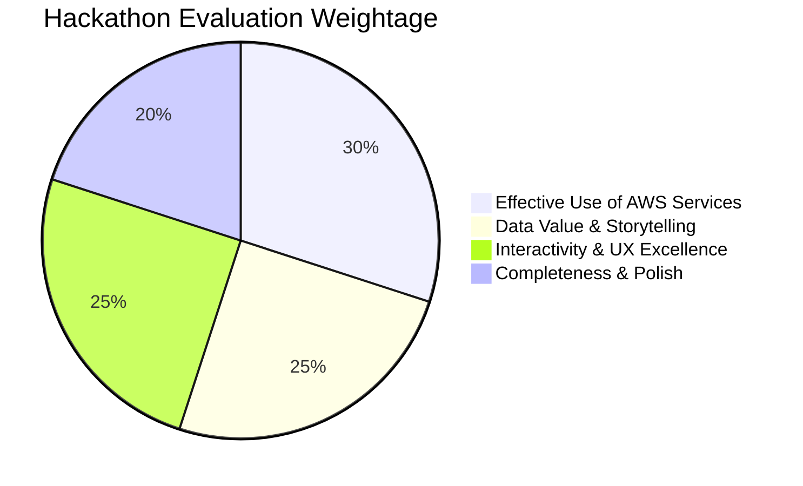

# 01 — Challenge Overview: Weekend Challenge: Map it

> **AWS Builder Center Hackathon Reference Sheet**

---

## 1. Challenge Details & Metadata

| Attribute | Details |
| :--- | :--- |
| **Official Title** | Weekend Challenge: Map it |
| **Host** | AWS Builder Center |
| **Status** | Live |
| **Start Date** | October 30, 2026 (12:00 AM PDT / 12:30 PM IST) |
| **End Date / Deadline** | November 2, 2026 (1:00 PM PST / 1:30 AM Nov 3 IST) |
| **Total Duration** | ~85 hours (Weekend Rapid Sprint) |
| **Format** | Online / Virtual, Public, Open to all builders |
| **Submission Platform** | AWS Builder Center Projects Portal |

---

## 2. Core Prompt & Problem Statement

> *"Data is easier to understand when you can see it on a map. This weekend, put some on one. Build an app that places location or spatial data on a map using an AWS location or data service."*

Spatial visualization transforms abstract numbers, coordinates, and spreadsheets into intuitive human experiences. Builders are challenged to take real-world datasets containing geographic features (lat/lon, bounding boxes, polygons, addresses, movement trajectories) and build an interactive web or mobile application on AWS.

---

## 3. Mandatory Submission Requirements

To be eligible for judging, your project submission must contain the following 4 elements:

1. **The Dataset Specification**:
   - Explicitly identify the dataset(s) used (e.g., Registry of Open Data on AWS, USGS Earthquake API, NOAA climate data, OpenStreetMap, local municipality open data portal).
   - Describe what attributes the dataset holds and why visualizing it geospatially unlocks new insights.
2. **AWS Services & Mapping Architecture**:
   - Provide an explanation of how the data was ingested, transformed, and mapped.
   - You **must** utilize at least one AWS location or spatial data service:
     - **Amazon Location Service** (Maps, Places, Routes, Geofences, Trackers) — *Primary recommendation*
     - **Amazon S3** (Hosting GeoJSON, Vector Tiles, or Static Assets)
     - **Amazon Athena / S3 / Apache Iceberg** (Spatial SQL queries with Geo functions)
     - **AWS Lambda & Amazon API Gateway** (Serverless backend for spatial data filtering)
3. **Live, Working Map Deployment**:
   - A publicly accessible URL to your running application (hosted on AWS Amplify Hosting, Amazon CloudFront + S3, or similar).
   - Alternatively, for projects with restricted external access, a clear, unedited live screen capture demonstration.
4. **Code Repository & Video Demo**:
   - Public code repository (GitHub, GitLab, or AWS CodeCommit) with clean code and setup instructions.
   - A video demonstration (under 3 minutes) walking through the motivation, the architecture, AWS services used, and interactive features of the map.

---

## 4. Evaluation Criteria & Winning Rubric

Judges on AWS Builder Center score entries across four primary dimensions:

1. **Effective Use of AWS Services (30%)**:
   - Correct, native integration of Amazon Location Service (tiles, place index, routing, or geofences).
   - Clean cloud architecture (e.g., secure auth via Amazon Cognito Identity Pools, serverless caching, minimal latency).
2. **Data Value & Storytelling (25%)**:
   - The dataset must answer a meaningful question or solve a genuine problem.
   - Visual layers must not just dump raw pins; they should use color ramps, heatmaps, clustering, or popups to communicate patterns.
3. **Interactivity & UX Excellence (25%)**:
   - Fluid map pan/zoom, responsive controls, search-as-you-type, category filtering, route recalculation, and cross-device responsiveness.
   - Clean modern UI design without clutter.
4. **Completeness & Polish (20%)**:
   - No broken links, clear instructions in the README, polished 3-minute video pitch, and working live deployment.

---

## 5. Critical Constraints & Weekend Sprint Strategy

- **Time is your primary constraint (72-85 hours):** Do not spend 2 days configuring complex container clusters or Kubernetes. Choose lightweight serverless technologies:
  - **Frontend:** React + Vite or Next.js + MapLibre GL JS + `@aws-amplify/geo` or AWS SDK.
  - **Hosting:** AWS Amplify Hosting (1-click GitHub connection, automatic HTTPS).
  - **Auth:** Amazon Cognito Unauthenticated Identity Pool (scoped strictly to `geo:GetMap*` and `geo:SearchPlaceIndex*`).
  - **Backend:** Static GeoJSON cached on S3 / CloudFront or thin AWS Lambda functions for real-time querying.

