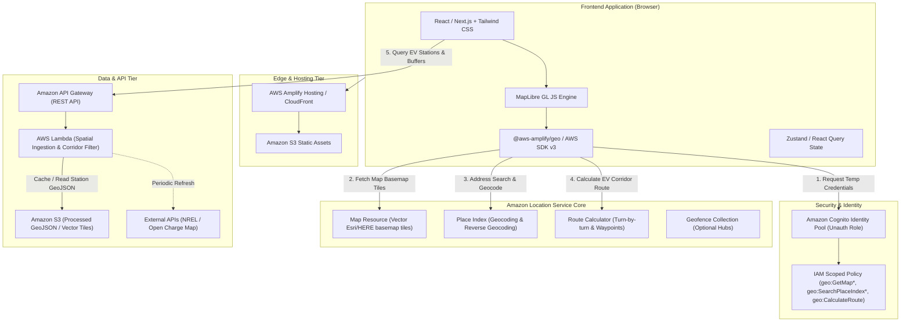

# 03 — System Architecture: Weekend Challenge: Map it

This document outlines the cloud and frontend architecture for **EcoRoute** (and adaptable for the other challenge concepts). The design emphasizes **zero-friction client rendering**, **secure AWS credential management via Cognito**, and **high-performance serverless spatial queries**.

---

## 🏛️ End-to-End System Architecture Diagram



---

## ⚙️ Component Breakdown & Interactions

### 1. Frontend Client Layer
- **Framework:** React 18 / Vite or Next.js 14 (SPA mode). Fast hot-reloading and lightweight builds.
- **Map Renderer:** **MapLibre GL JS** (open-source, WebGL-accelerated client that natively supports Amazon Location Service vector tiles and glyphs).
- **AWS Integration:**
  - `@aws-sdk/client-location` for direct Route and Place calculations.
  - `@aws-amplify/geo` or `maplibre-gl-js-amplify` for zero-boilerplate map basemap initialization.
- **Styling:** Tailwind CSS + Radix UI / Lucide icons for modern dark-mode aesthetic with collapsible panels, elevation graphs, and station cards.

### 2. AWS Authentication & Security Architecture
A common beginner pitfall in AWS hackathons is hardcoding AWS IAM Access Keys into frontend client bundles. To score full points for AWS security best practices:
- **Amazon Cognito Identity Pool**:
  - Enable **Unauthenticated Identities** (allows anonymous public visitors to load the map and search places without forcing an account signup).
  - Attach an IAM Role with strict, read-only permissions scoped specifically to the ARN of the Map, Place Index, and Route Calculator resources.

```json
{
  "Version": "2012-10-17",
  "Statement": [
    {
      "Effect": "Allow",
      "Action": [
        "geo:GetMapGlyphs",
        "geo:GetMapSprites",
        "geo:GetMapStyleDescriptor",
        "geo:GetMapTile"
      ],
      "Resource": "arn:aws:geo:<region>:<account-id>:map/EcoRouteMap"
    },
    {
      "Effect": "Allow",
      "Action": [
        "geo:SearchPlaceIndexForText",
        "geo:SearchPlaceIndexForPosition"
      ],
      "Resource": "arn:aws:geo:<region>:<account-id>:place-index/EcoRoutePlaceIndex"
    },
    {
      "Effect": "Allow",
      "Action": [
        "geo:CalculateRoute"
      ],
      "Resource": "arn:aws:geo:<region>:<account-id>:route-calculator/EcoRouteCalculator"
    }
  ]
}
```

### 3. Amazon Location Service Core
- **Map Resource:** `VectorEsriNavigation` or `VectorHereExplore` style. Provides high-clarity highways, arterial roads, elevation contours, and city labels.
- **Place Index:** Provides instant auto-complete suggestions when the user types a city, street, or destination.
- **Route Calculator:** Computes car/truck driving routes, providing distance, estimated travel time, turn-by-turn maneuvers, and polyline coordinates.

### 4. Spatial Data Pipeline
1. **Dataset Ingestion:**
   - A serverless script downloads EV station records from NREL / Open Charge Map for the target geographic scope (e.g., California or Interstate-95 corridor).
   - Generates a compact GeoJSON FeatureCollection (`stations.geojson`) stored in Amazon S3 with gzip compression and cache headers.
2. **Corridor Buffering (The "Along Route" Feature):**
   - When a route is generated between Point A and Point B, the client polyline is passed to the backend (or evaluated locally with `@turf/turf`).
   - The app filters stations within a 3-mile to 5-mile buffer along the route line, displaying only viable chargers.

---

## 🔒 Scalability, Performance & Cost Safeguards

- **Client-Side Vector Rendering:** MapLibre renders tiles on the client's GPU, reducing server-side load to virtually zero.
- **S3 & CloudFront Caching:** Static datasets are cached at CloudFront edge locations with `Cache-Control: public, max-age=86400`.
- **AWS Free Tier Shield:**
  - Amazon Location Service includes generous free tier limits: **3 months free up to 500,000 map tile requests, 1,000 geocoding searches, and 1,000 routes/month**.
  - All hosting on AWS Amplify Hosting is within the free tier.
  - S3 and Lambda operations will cost under \$0.05 for hackathon demo traffic.

