# 05 — Implementation Roadmap: Weekend Challenge: Map it

> **72-Hour Rapid Sprint Schedule (Friday Kickoff to Monday Submission)**

---

## ⏱️ Timeline Milestones At A Glance

```mermaid
gantt
    title 72-Hour Map It Hackathon Sprint Schedule
    dateFormat  X
    axisFormat Day %d
    section Phase 1: Setup & Cloud
    Cloud Provisioning (Location, Cognito, S3) :0, 12
    Dataset Acquisition & Normalization        :6, 16
    section Phase 2: Core Map Dev
    MapLibre GL Vector Tile Integration        :14, 26
    Spatial Layers, Markers & Clustering       :22, 38
    Places Search & Autocomplete               :34, 46
    section Phase 3: Route & Insights
    Route Calculation & Buffer Corridor        :42, 54
    Interactive Analytics Drawer & UX Polish    :50, 62
    section Phase 4: Deploy & Pitch
    AWS Amplify CI/CD Cloud Deployment         :58, 64
    Demo Video Recording (3 min max)           :62, 68
    Documentation & AWS Builder Submission     :66, 72
```

---

## 📅 Detailed Hour-by-Hour Execution Plan

### Block 1: Foundation & Cloud Provisioning (Hours 0 – 16)
- **Goal:** Working map rendered locally with zero authentication errors; verified clean GeoJSON dataset.
- **Tasks:**
  1. Initialize Git repository with React + Vite + Tailwind CSS (`npm create vite@latest app -- --template react-ts`).
  2. Install dependencies: `maplibre-gl`, `@aws-sdk/client-location`, `@turf/turf`, `lucide-react`.
  3. Execute AWS CLI provisioning scripts to create:
     - Map Resource: `EcoRouteMap` (using `VectorEsriNavigation`).
     - Place Index: `EcoRoutePlaceIndex` (using `Esri`).
     - Route Calculator: `EcoRouteCalculator` (using `Esri`).
     - Cognito Identity Pool with unauthenticated access policy.
  4. Acquire dataset: Download NREL / Open Charge Map EV station JSON or USGS earthquake GeoJSON.
  5. Convert dataset into a single standard GeoJSON `FeatureCollection` with normalized properties (`id`, `name`, `status`, `power_kw`, `ports`, `address`).

### Block 2: Interactive Map & Spatial Clustering (Hours 16 – 38)
- **Goal:** Rich, smooth map rendering tens of thousands of data points at 60 FPS.
- **Tasks:**
  1. Integrate MapLibre GL JS with Amazon Location Service tile endpoints.
  2. Add GeoJSON data source with MapLibre built-in clustering enabled (`cluster: true`, `clusterRadius: 50`).
  3. Style cluster circles by count (e.g., small green `< 10`, medium blue `10-100`, large orange `> 100`).
  4. Implement interactive marker clicks: render a polished popup showing station name, connector icons, power speed, and a *"Route Here"* button.
  5. Build filter sidebar: filter points by power speed (Level 2 vs DC Fast) and network provider.

### Block 3: Places Search & Corridor Routing (Hours 38 – 54)
- **Goal:** Full interactive navigation with Amazon Location Service Places & Routes.
- **Tasks:**
  1. Build an address search bar with debounce (300ms) calling `SearchPlaceIndexForSuggestions` / `SearchPlaceIndexForText`.
  2. On suggestion click, fly the camera (`map.flyTo`) to selected coordinates and place an origin pin.
  3. Implement route calculation:
     - Send origin `[lon, lat]` and destination `[lon, lat]` to `CalculateRoute`.
     - Decode route summary (`Distance`, `DurationSeconds`) and coordinates.
     - Add route line layer onto the map with a glowing gradient line.
  4. Spatial buffer feature: Use `@turf/buffer` on the route polyline (e.g. 5 km radius) and highlight only charging stations that fall inside this travel corridor.

### Block 4: UI Polish, Insights Dashboard & Cloud Deployment (Hours 54 – 64)
- **Goal:** Public live URL on AWS Amplify Hosting with zero console errors.
- **Tasks:**
  1. Build an analytics HUD or slide-over drawer:
     - Total route mileage and travel time.
     - Number of EV fast chargers along corridor.
     - Estimated carbon offset / gallons of gasoline saved.
  2. Responsive design testing (ensure layout functions seamlessly on mobile and desktop).
  3. Push repository to GitHub.
  4. Connect GitHub repo to **AWS Amplify Hosting**:
     - Configure build settings (`npm run build`).
     - Set environment variables (`VITE_AWS_REGION`, `VITE_MAP_NAME`, `VITE_COGNITO_IDENTITY_POOL_ID`).
     - Verify live SSL URL (`https://main.<app-id>.amplifyapp.com`).

### Block 5: Video Pitch, Documentation & Submission (Hours 64 – 72)
- **Goal:** Complete, high-scoring submission submitted before the deadline.
- **Tasks:**
  1. Record 3-minute demo video using OBS Studio or Loom following the script in [`06_SUBMISSION_AND_DEMO_GUIDE.md`](./06_SUBMISSION_AND_DEMO_GUIDE.md).
  2. Upload video to YouTube (unlisted) or Loom.
  3. Write comprehensive GitHub `README.md` with architecture diagrams and setup instructions.
  4. Fill out the AWS Builder Center submission form:
     - Project title and tagline.
     - Dataset description and source link.
     - AWS services used explanation.
     - Public GitHub URL and live Amplify demo URL.
     - Video demo link.
  5. Submit at least 2 hours before the hard cutoff!

